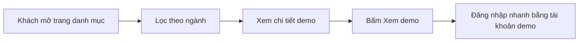

# Tổng quan nghiệp vụ — Danh mục Demo

> Mô tả demo này cho ai, giải quyết vấn đề gì. Cập nhật khi phạm vi thay đổi.

---

## 1. Thông tin chung

| Mục | Nội dung |
| :--- | :--- |
| Tên demo | Danh mục Demo |
| Mã dự án | `web-danh-muc-demo` |
| Ngành / loại khách hàng | Nội bộ: trang trình bày mọi demo cho khách hàng |
| Loại sản phẩm | Website (FE là chính) + trang quản trị danh sách demo |
| Ý tưởng gốc | 0.1 · Trang danh mục demo (`ZDOCS/02-KE-HOACH/DANH-SACH-Y-TUONG.md`) |
| Người phụ trách | |
| Trạng thái | Có tài liệu nghiệp vụ (SRS, use case, kịch bản demo, kịch bản kiểm thử), chưa code |

## 2. Vấn đề của khách hàng

- Khi gặp khách, mất thời gian tìm đúng link demo và tài khoản đăng nhập
- Các demo nằm rải rác, khách không thấy được toàn bộ giải pháp công ty có
- Sales không biết demo nào đang chạy được, demo nào còn đang làm

## 3. Giải pháp demo thể hiện

- Một trang duy nhất hiển thị mọi demo dạng thẻ có ảnh, lọc theo ngành, tìm kiếm
- Trang chi tiết từng demo: ảnh chụp, tính năng nổi bật, link, tài khoản demo
- Quản trị thêm/sửa/ẩn demo, sắp xếp thứ tự, gắn trạng thái

## 4. Vai trò người dùng

| Vai trò | Mã | Dùng trên | Làm được gì |
| :--- | :--- | :--- | :--- |
| Khách xem | — | Điện thoại, desktop | Xem danh mục, mở demo (không cần đăng nhập) |
| Quản trị viên | ADMIN | Desktop | Toàn quyền |
| Quản lý | MANAGER | Desktop | Cập nhật thông tin demo, ảnh, trạng thái |
| Nhân viên kinh doanh | STAFF | Desktop | Xem ghi chú nội bộ, kịch bản demo của từng dự án |

## 5. Phân hệ và chức năng

| Area | Chức năng | Màn hình (route FE dự kiến) | Ưu tiên |
| :--- | :--- | :--- | :---: |
| `System` | Đăng nhập, tài khoản, vai trò, cài đặt | Có sẵn | — |
| `Cms` | Danh mục demo: lưới thẻ, lọc ngành, tìm kiếm | `/` | P1 |
| `Cms` | Chi tiết demo | `/demos/[slug]` | P1 |
| `Cms` | Quản lý demo (thêm, sửa, ẩn, sắp xếp) | `/admin/demos` | P1 |
| `Cms` | Thêm, sửa demo: thông tin, ảnh chụp, tài khoản demo, ghi chú nội bộ | `/admin/demos/[id]` | P1 |
| `Cms` | Nhóm ngành | `/admin/categories` | P2 |
| `Cms` | Thống kê lượt xem demo | `/admin/reports` | P3 |

P1 = bắt buộc có để demo · P2 = nên có · P3 = làm thêm nếu còn thời gian.

## 6. Luồng nghiệp vụ chính

## 7. Phạm vi

**Có trong demo:**

- Danh mục các demo đang có trong kho, ảnh chụp và link từng demo
- Trang quản trị danh sách demo

**Không làm (nói rõ với khách nếu được hỏi):**

- Đăng ký tài khoản cho khách, thanh toán
- Các kết nối bên ngoài khác chỉ giả lập

## 8. Dữ liệu mẫu cần chuẩn bị

| Dữ liệu | Số lượng | Ghi chú |
| :--- | :---: | :--- |
| Demo | 18 | Lấy từ ZDOCS/02-KE-HOACH/DANH-SACH-DU-AN.md |
| Nhóm ngành | 11 | Theo DANH-SACH-Y-TUONG.md |
| Ảnh chụp màn hình | 3–5 mỗi demo | Chụp khi demo chạy được |
