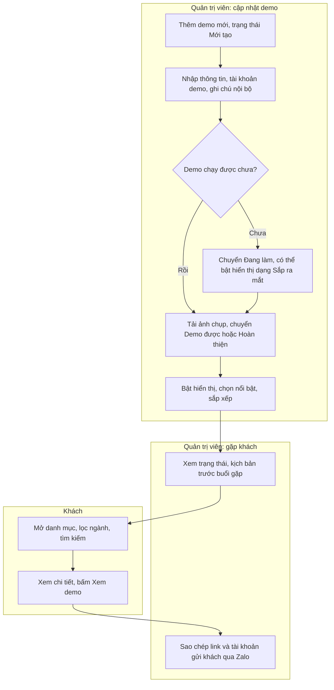
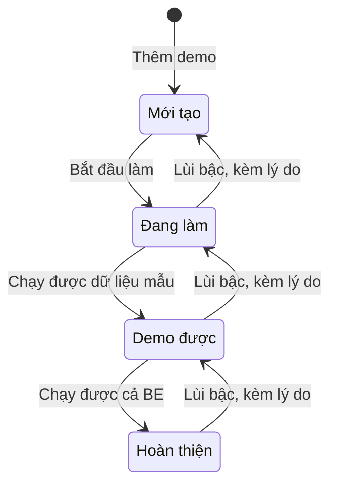
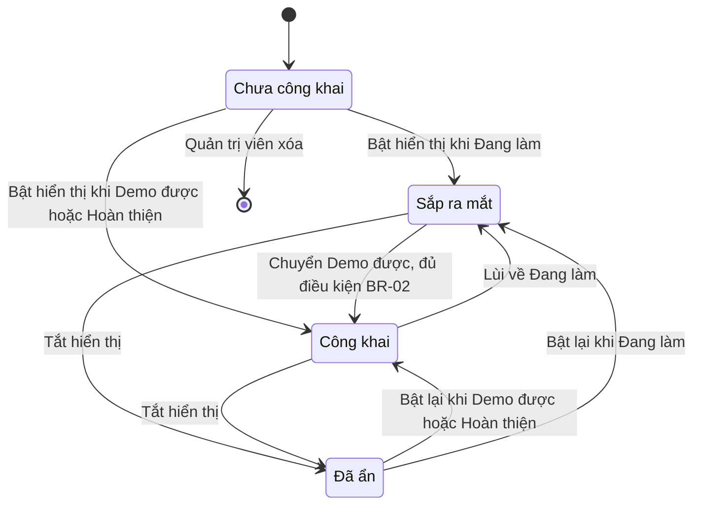

# Đặc tả yêu cầu phần mềm (SRS) — Danh mục Demo

| Phiên bản | Ngày | Trạng thái |
| :--- | :--- | :--- |
| 1.0 | 12/10/2026 | Bản nháp để triển khai demo |

> Cách viết, quy ước mã, mức độ chi tiết: `ZDOCS/05-HUONG-DAN/HUONG-DAN-VIET-TAI-LIEU-NGHIEP-VU.md`.
> Phần nền (đăng nhập, tài khoản, vai trò, cài đặt, đặt lại dữ liệu demo): `ZDOCS/03-KIEN-TRUC/USE-CASE-NEN.md`, không viết lại ở đây.

---

## 1. Giới thiệu

### 1.1. Mục đích

Tài liệu mô tả đầy đủ yêu cầu của Danh mục Demo: trang công khai giới thiệu mọi demo của PUM, khu thông tin nội bộ và trang quản trị danh sách demo dành cho Quản trị viên. Dev dùng để code, tester dùng để viết và chạy test case, người trình bày demo dùng để biết trang làm được gì.

### 1.2. Phạm vi

**Trong phạm vi:** trang danh mục có lọc theo nhóm ngành và tìm kiếm, trang chi tiết demo (ảnh chụp, tính năng, tài khoản demo, nút Xem demo), thông tin nội bộ cho Quản trị viên (mật khẩu demo, ghi chú, kịch bản), sao chép thông tin gửi khách, quản lý demo (thông tin, ảnh, tài khoản demo, trạng thái, hiển thị, nổi bật, thứ tự), nhóm ngành (P2), thống kê lượt xem (P3).

**Ngoài phạm vi:** đăng ký tài khoản cho khách, thanh toán, form đặt lịch tư vấn, tự kiểm tra link demo còn chạy, đồng bộ tự động với `DANH-SACH-DU-AN.md` hoặc GitHub, song ngữ.

### 1.3. Thuật ngữ

| Thuật ngữ | Giải thích |
| :--- | :--- |
| Demo | Một sản phẩm mẫu chạy được, ứng với một dự án trong kho, vd "POS Quán Cafe" |
| Khách | Người xem trang danh mục, không đăng nhập: doanh nghiệp nhỏ, sinh viên làm đồ án |
| Quản trị viên | Chủ kho demo (Mạnh Hùng), đăng nhập bằng tài khoản `admin`, có toàn quyền |
| Danh mục | Trang công khai liệt kê các demo dạng lưới thẻ |
| Nhóm ngành | Phân loại demo theo ngành của khách hàng, vd F&B, Bán lẻ |
| Trạng thái phát triển | Mức hoàn thiện kỹ thuật của demo: Mới tạo, Đang làm, Demo được, Hoàn thiện |
| Demo được | Demo chạy được bằng dữ liệu mẫu, chưa cần BE |
| Hoàn thiện | Demo chạy được cả FE và BE thật |
| Hiển thị | Công tắc cho phép demo xuất hiện trên danh mục |
| Công khai | Demo đang bật Hiển thị và ở trạng thái Demo được hoặc Hoàn thiện; khách mở được demo |
| Sắp ra mắt | Demo đang bật Hiển thị nhưng ở trạng thái Đang làm; khách thấy thẻ, không mở được demo |
| Nổi bật | Demo được ưu tiên ở đầu danh mục, tối đa 6 |
| Slug | Phần cuối đường dẫn trang chi tiết, vd `pos-quan-cafe` |
| Tài khoản demo | Tài khoản đăng nhập sẵn của một demo, vd `thungan` của POS Quán Cafe |
| Thông tin nội bộ | Mật khẩu demo, ghi chú, kịch bản tóm tắt, câu hỏi khách hay hỏi; chỉ Quản trị viên (quyền `demos.view-internal`) mới thấy |
| Lượt xem | Một lần khách mở trang chi tiết demo, tính theo BR-14 |
| Lượt mở demo | Một lần khách bấm "Xem demo", tính theo BR-14 |

### 1.4. Tài liệu liên quan

| Tài liệu | Nội dung |
| :--- | :--- |
| `01-TONG-QUAN-NGHIEP-VU.md` | Tổng quan nghiệp vụ |
| `03-USE-CASE.md` | Đặc tả use case |
| `05-KICH-BAN-KIEM-THU.md` | Test case nghiệm thu, dữ liệu mẫu dùng trong test |
| `ZDOCS/03-KIEN-TRUC/USE-CASE-NEN.md` | Phần nền dùng chung |
| `ZDOCS/02-KE-HOACH/DANH-SACH-DU-AN.md` | Danh sách 18 demo, cổng FE/BE, dùng làm dữ liệu mẫu |
| `ZDOCS/02-KE-HOACH/DANH-SACH-Y-TUONG.md` | 11 nhóm ngành, mã ý tưởng gốc |

---

## 2. Mô tả tổng quan

### 2.1. Bối cảnh sản phẩm

PUM có 18 demo nằm ở 18 repo, mỗi demo một cổng và một bộ tài khoản riêng. Danh mục Demo gom tất cả vào một link duy nhất. Khi gặp khách, Mạnh Hùng mở danh mục trên laptop hoặc điện thoại, lọc đúng ngành của khách, mở demo phù hợp. Trước buổi gặp, anh đăng nhập `admin` để xem trạng thái và kịch bản của demo trong khu nội bộ; sau buổi gặp thì sao chép link và tài khoản gửi khách qua Zalo. Demo mới, ảnh chụp, trạng thái cũng do chính anh cập nhật trên trang quản trị. Khách muốn đi sâu hơn thì liên hệ qua hotline hoặc Zalo ghi trên trang.

### 2.2. Tác nhân

| Mã vai trò | Tên | Thiết bị | Mục tiêu khi dùng hệ thống |
| :--- | :--- | :--- | :--- |
| — | Khách | Điện thoại, desktop | Tìm nhanh demo đúng ngành, xem ảnh, mở demo chạy thật, liên hệ hotline hoặc Zalo |
| `ADMIN` | Quản trị viên | Desktop, điện thoại | Toàn quyền: cập nhật thông tin, ảnh, trạng thái demo; quyết định demo nào công khai, nổi bật; xem thông tin nội bộ, đọc kịch bản trước buổi gặp; gửi link và tài khoản cho khách; cấu hình hệ thống, xóa demo nhập sai |

Tài khoản nội bộ duy nhất: `admin`. Khách không cần tài khoản. Hệ thống không có vai trò Quản lý hay Nhân viên; mọi mã quyền nghiệp vụ (§7) đều cấp cho `ADMIN`.

### 2.3. Quy trình nghiệp vụ



### 2.4. Giả định và ràng buộc

- Trang danh mục và trang chi tiết là trang công khai, không cần đăng nhập. Trang quản trị dùng đăng nhập và phân quyền của phần nền.
- Sau khi đăng nhập, trang mặc định là Quản lý demo (`/admin/demos`); thẻ tổng hợp ở đầu trang này thay cho trang Tổng quan.
- Mỗi demo thuộc đúng một nhóm ngành; tìm chéo ngành bằng từ khóa.
- Link demo trong dữ liệu mẫu là `http://localhost:31NN` theo cổng ở `DANH-SACH-DU-AN.md`; khi đưa lên mạng thì đổi thành link online.
- Mật khẩu demo là mật khẩu chung `DEMO_PASSWORD` của từng dự án; chỉ Quản trị viên mới thấy.
- Hệ thống không tự kiểm tra link demo còn chạy; Quản trị viên tự cập nhật trạng thái.
- Trạng thái demo trong dữ liệu mẫu là giả định để đủ mọi trường hợp, không phải tiến độ thật của kho.
- Ở chế độ `mock`, ảnh tải lên lưu tạm trong trình duyệt và mất khi đặt lại dữ liệu.

---

## 3. Yêu cầu chức năng

### 3.1. Danh mục công khai

| Mã | Yêu cầu | Ưu tiên | Vai trò | UC |
| :--- | :--- | :---: | :--- | :--- |
| FR-01 | Trang danh mục hiển thị lưới thẻ các demo theo BR-01, BR-04; mỗi thẻ có ảnh đại diện, tên, nhãn nhóm ngành, mô tả ngắn, nhãn trạng thái (Hoàn thiện, Demo được, Sắp ra mắt), nút "Xem demo" và "Chi tiết" | P1 | Khách | UC-01 |
| FR-02 | Khách lọc demo theo nhóm ngành bằng hàng nút chọn nhanh, mỗi nút kèm số demo; mặc định chọn "Tất cả" | P1 | Khách | UC-01 |
| FR-03 | Khách tìm demo theo từ khóa trên tên, mô tả ngắn, tính năng nổi bật và từ khóa của demo; gõ không dấu vẫn tìm được (BR-03) | P1 | Khách | UC-01 |
| FR-04 | Nhóm ngành và từ khóa đang lọc được ghi lên đường dẫn, vd `/?nganh=fnb&q=pos`; mở đường dẫn đó cho ra đúng kết quả | P2 | Khách, ADMIN | UC-01, UC-04 |
| FR-05 | Đầu trang và chân trang hiển thị tên, logo, hotline, nút Zalo của PUM lấy từ cài đặt chung; bấm hotline trên điện thoại thì gọi ngay | P2 | Khách | UC-01 |

### 3.2. Chi tiết demo

| Mã | Yêu cầu | Ưu tiên | Vai trò | UC |
| :--- | :--- | :---: | :--- | :--- |
| FR-06 | Trang chi tiết hiển thị tên, nhóm ngành, nhãn trạng thái, đối tượng khách hàng, vấn đề giải quyết, mô tả chi tiết, tính năng nổi bật, loại sản phẩm, thiết bị sử dụng | P1 | Khách | UC-02 |
| FR-07 | Trang chi tiết có thư viện ảnh chụp màn hình: ảnh lớn, dãy ảnh nhỏ, bấm để phóng to toàn màn hình, vuốt hoặc bấm phím mũi tên để chuyển ảnh | P1 | Khách | UC-02 |
| FR-08 | Nút "Xem demo" mở link demo trong tab mới; bảng tài khoản demo gồm tên đăng nhập, vai trò, dùng để xem gì, kèm hướng dẫn "Đăng nhập nhanh"; trang công khai không hiển thị mật khẩu | P1 | Khách | UC-02 |
| FR-09 | Trang chi tiết gợi ý tối đa 3 demo công khai khác cùng nhóm ngành, theo thứ tự BR-04 | P2 | Khách | UC-02 |
| FR-10 | Trang chi tiết có tiêu đề, mô tả meta và ảnh chia sẻ lấy từ tên, mô tả ngắn, ảnh đại diện, để link gửi qua Zalo, Facebook hiện ảnh xem trước | P2 | Khách | UC-02 |
| FR-11 | Mở slug cũ được chuyển hướng tới slug mới (BR-06); slug không tồn tại hoặc demo không hiển thị cho khách thì hiện trang "Không tìm thấy demo" có nút về danh mục | P2 | Khách | UC-02 |

### 3.3. Thông tin nội bộ

| Mã | Yêu cầu | Ưu tiên | Vai trò | UC |
| :--- | :--- | :---: | :--- | :--- |
| FR-12 | Quản trị viên (quyền `demos.view-internal`) thấy thêm khung "Thông tin nội bộ" trên trang chi tiết: trạng thái phát triển, người phụ trách, mật khẩu demo, link Swagger, repo, ghi chú nội bộ, kịch bản tóm tắt, câu hỏi khách hay hỏi kèm câu trả lời gợi ý | P1 | ADMIN | UC-03 |
| FR-13 | Quản trị viên (quyền `demos.view-internal`) mở được trang chi tiết của demo chưa công khai ở chế độ xem trước, có dải nhãn "Xem trước, khách không thấy trang này" | P1 | ADMIN | UC-03, UC-05 |
| FR-14 | Quản trị viên bấm "Sao chép gửi khách" để chép đoạn văn bản gồm tên demo, link, tài khoản demo và hướng dẫn đăng nhập theo mẫu BR-17; tùy chọn kèm mật khẩu | P2 | ADMIN | UC-04 |
| FR-15 | Quản trị viên bấm "Sao chép link" ở trang danh mục để chép đường dẫn đang lọc theo nhóm ngành và từ khóa | P2 | ADMIN | UC-04 |

### 3.4. Quản lý demo

| Mã | Yêu cầu | Ưu tiên | Vai trò | UC |
| :--- | :--- | :---: | :--- | :--- |
| FR-16 | Trang quản lý demo có thẻ tổng hợp số demo theo trạng thái phát triển, số đang hiển thị, số nổi bật trên 6; bảng mọi demo gồm số thứ tự, ảnh nhỏ, tên, nhóm ngành, trạng thái, hiển thị, nổi bật, người phụ trách, ngày cập nhật; lọc theo nhóm ngành, trạng thái, hiển thị; tìm theo tên hoặc mã dự án | P1 | ADMIN | UC-03, UC-05 |
| FR-17 | Quản trị viên thêm, sửa demo: số thứ tự, mã dự án, tên, slug, nhóm ngành, ý tưởng gốc, đối tượng khách hàng, vấn đề giải quyết, loại sản phẩm, thiết bị, mô tả ngắn, mô tả chi tiết, tính năng nổi bật, từ khóa, link demo, link Swagger, repo, người phụ trách | P1 | ADMIN | UC-05 |
| FR-18 | Quản trị viên tải lên, sắp xếp, xóa ảnh chụp màn hình, nhập chú thích từng ảnh và chọn ảnh đại diện | P1 | ADMIN | UC-06 |
| FR-19 | Quản trị viên khai báo tài khoản demo của từng demo (tên đăng nhập, tên vai trò, dùng để xem gì, thứ tự), bật/tắt "Cần đăng nhập" và nhập mật khẩu demo | P1 | ADMIN | UC-05 |
| FR-20 | Quản trị viên nhập ghi chú nội bộ, kịch bản tóm tắt, danh sách câu hỏi khách hay hỏi kèm câu trả lời gợi ý | P1 | ADMIN | UC-05 |
| FR-21 | Quản trị viên đổi trạng thái phát triển theo BR-11; hệ thống lưu lịch sử đổi trạng thái gồm trạng thái cũ, trạng thái mới, lý do, người đổi, thời điểm | P1 | ADMIN | UC-07 |
| FR-22 | Quản trị viên bật, tắt hiển thị; trước khi bật, hệ thống kiểm tra BR-02 và liệt kê từng mục còn thiếu | P1 | ADMIN | UC-07 |
| FR-23 | Quản trị viên đánh dấu, bỏ đánh dấu nổi bật và kéo thả để sắp xếp thứ tự hiển thị | P1 | ADMIN | UC-08 |
| FR-24 | Quản trị viên xóa demo chưa từng công khai (BR-12) | P2 | ADMIN | UC-05 |

### 3.5. Nhóm ngành

| Mã | Yêu cầu | Ưu tiên | Vai trò | UC |
| :--- | :--- | :---: | :--- | :--- |
| FR-25 | Quản trị viên thêm, sửa, sắp xếp nhóm ngành: mã, tên, slug, biểu tượng, màu nhãn, mô tả; danh sách hiển thị số demo của mỗi nhóm | P2 | ADMIN | UC-09 |
| FR-26 | Quản trị viên xóa nhóm ngành chưa có demo nào (BR-13) | P2 | ADMIN | UC-09 |

### 3.6. Thống kê

| Mã | Yêu cầu | Ưu tiên | Vai trò | UC |
| :--- | :--- | :---: | :--- | :--- |
| FR-27 | Hệ thống ghi lượt xem trang chi tiết và lượt mở demo của khách theo BR-14 | P3 | — | UC-10 |
| FR-28 | Quản trị viên xem thống kê theo khoảng ngày: lượt xem, lượt mở demo, tỉ lệ mở theo ngày; top 10 demo; tỉ trọng theo nhóm ngành và theo thiết bị | P3 | ADMIN | UC-10 |
| FR-29 | Quản trị viên xuất thống kê đang xem ra file Excel | P3 | ADMIN | UC-10 |

---

## 4. Quy tắc nghiệp vụ

| Mã | Quy tắc | Áp dụng cho |
| :--- | :--- | :--- |
| BR-01 | Demo xuất hiện trên danh mục khi bật Hiển thị và trạng thái là Demo được, Hoàn thiện (thẻ đầy đủ, có nút Xem demo) hoặc Đang làm (thẻ "Sắp ra mắt", không có nút Xem demo). Demo Mới tạo không bật Hiển thị được | FR-01, FR-22 |
| BR-02 | Điều kiện bật Hiển thị: có mô tả ngắn và ít nhất 3 tính năng nổi bật. Với Demo được, Hoàn thiện cần thêm: ít nhất 1 ảnh chụp, link demo hợp lệ, ít nhất 1 tài khoản demo khi bật "Cần đăng nhập". Demo đang hiển thị thì mọi thao tác sửa, xóa ảnh, đổi trạng thái làm mất điều kiện này đều bị từ chối | FR-17, FR-18, FR-21, FR-22 |
| BR-03 | Tìm kiếm: từ khóa và dữ liệu được chuẩn hóa về chữ thường, bỏ dấu, `đ` thành `d`, gộp khoảng trắng thừa. Demo khớp khi chuỗi từ khóa đã chuẩn hóa nằm trong tên, mô tả ngắn, một tính năng nổi bật hoặc một từ khóa của demo. Từ khóa dưới 2 ký tự thì không lọc. Tìm kiếm kết hợp với nhóm ngành đang chọn theo điều kiện "và" | FR-03 |
| BR-04 | Thứ tự trên danh mục: (1) demo công khai trước demo Sắp ra mắt; (2) trong mỗi phần, demo nổi bật trước; (3) thứ tự tăng dần; (4) tên từ A đến Z. Tối đa 6 demo nổi bật; chỉ demo công khai mới được đánh dấu nổi bật | FR-01, FR-09, FR-23 |
| BR-05 | Slug dài 3–60 ký tự, gồm chữ thường không dấu, số, dấu `-`, không bắt đầu hoặc kết thúc bằng `-`, không trùng. Khi thêm mới, slug tự sinh từ tên: "POS Quán Cafe" thành `pos-quan-cafe`; trùng thì thêm `-2`, `-3` | FR-17 |
| BR-06 | Đổi slug của demo đã từng công khai: hệ thống lưu slug cũ, mở slug cũ thì chuyển hướng vĩnh viễn (301) tới slug mới. Slug cũ không được dùng lại cho demo khác | FR-11, FR-17 |
| BR-07 | Ảnh chụp: JPG, PNG hoặc WebP; tối đa 2 MB mỗi ảnh; rộng tối thiểu 1280 px; tối đa 8 ảnh mỗi demo; chú thích tối đa 125 ký tự. Chưa chọn ảnh đại diện thì lấy ảnh đầu tiên. Demo chưa có ảnh dùng ảnh mặc định theo màu nhóm ngành kèm tên demo | FR-01, FR-07, FR-18 |
| BR-08 | Độ dài: tên bắt buộc, tối đa 60 ký tự; mô tả ngắn khi nhập phải dài 50–160 ký tự; tối đa 6 tính năng nổi bật, mỗi mục tối đa 80 ký tự; tối đa 10 từ khóa; ghi chú nội bộ tối đa 2.000 ký tự. Demo chưa hiển thị được để trống mô tả ngắn và tính năng nổi bật | FR-17, FR-20 |
| BR-09 | Mã dự án dài 3–40 ký tự, gồm chữ thường không dấu, số, dấu `-`, không trùng, không đổi sau khi tạo. Số thứ tự là số 2 chữ số, không trùng, mặc định bằng số lớn nhất hiện có cộng 1. Thư mục tự ghép `{số thứ tự}-{mã dự án}`, vd `02-fnb-pos-cafe` | FR-17 |
| BR-10 | Mật khẩu demo, ghi chú nội bộ, kịch bản, câu hỏi khách hay hỏi, link Swagger, repo, người phụ trách không có trong API công khai và mã nguồn trang công khai; chỉ trả về khi người dùng có quyền `demos.view-internal` (hiện chỉ `ADMIN` được cấp) | FR-08, FR-12 |
| BR-11 | Trạng thái phát triển đi theo thứ tự Mới tạo → Đang làm → Demo được → Hoàn thiện. Tiến lên được nhảy bậc, không cần lý do. Lùi bậc bắt buộc nhập lý do 10–500 ký tự. Lùi về Đang làm: bỏ nổi bật, nếu đang hiển thị thì thẻ chuyển "Sắp ra mắt". Lùi về Mới tạo: tự tắt Hiển thị và bỏ nổi bật | FR-21 |
| BR-12 | Chỉ Quản trị viên xóa được demo, và chỉ demo chưa từng công khai (ngày công khai đầu tiên còn trống). Demo đã từng công khai chỉ tắt Hiển thị được | FR-24 |
| BR-13 | Nhóm ngành: mã và slug không trùng; không xóa nhóm còn demo. Trên danh mục, nút nhóm chỉ hiện khi nhóm có ít nhất 1 demo hiển thị; số trên nút đếm cả demo Sắp ra mắt. Tham số `nganh` không hợp lệ thì bỏ qua, hiển thị "Tất cả" | FR-02, FR-25, FR-26 |
| BR-14 | Lượt xem và lượt mở demo: cùng một trình duyệt, cùng một demo trong 30 phút chỉ tính 1 lượt mỗi loại. Trình duyệt nhận diện bằng mã ngẫu nhiên lưu trên trình duyệt, không chứa thông tin cá nhân. Không tính người đang đăng nhập và bot (user agent chứa `bot`, `crawler`, `spider`, `facebookexternalhit`) | FR-27 |
| BR-15 | Tỉ lệ mở demo = lượt mở demo ÷ lượt xem × 100%, làm tròn 1 chữ số thập phân; lượt xem bằng 0 thì hiển thị "—" | FR-28 |
| BR-16 | Mỗi demo có 0–6 tài khoản demo; tên đăng nhập theo BR-SYS-01, không trùng trong cùng một demo. Demo tắt "Cần đăng nhập" (vd landing page) không cần tài khoản và trang chi tiết ghi "Không cần đăng nhập" | FR-08, FR-19 |
| BR-17 | Sao chép gửi khách dùng mẫu cố định bên dưới. Mặc định không kèm mật khẩu; ô "Kèm mật khẩu" chỉ hiện với người có quyền `demos.view-internal`. Demo Sắp ra mắt không có nút sao chép gửi khách | FR-14 |
| BR-18 | Thứ tự là số nguyên 1–999. Kéo thả trong chế độ sắp xếp đánh lại thứ tự toàn bộ danh sách thành 10, 20, 30… theo vị trí mới. Chế độ sắp xếp chỉ bật khi không lọc, không tìm kiếm | FR-23 |

**Mẫu nội dung BR-17**

```
{Tên demo}
Xem demo: {link demo}
Tài khoản: {tên đăng nhập 1} ({vai trò 1}), {tên đăng nhập 2} ({vai trò 2})…
Cách vào: mở link, bấm "Đăng nhập nhanh" rồi chọn vai trò.
Mật khẩu: {mật khẩu demo}          ← chỉ có khi tick "Kèm mật khẩu"
Giới thiệu chi tiết: {link trang chi tiết}
```

---

## 5. Yêu cầu dữ liệu

### 5.1. Thực thể

| Thực thể | Mô tả | Thuộc tính chính | Quan hệ |
| :--- | :--- | :--- | :--- |
| Nhóm ngành | Phân loại demo theo ngành | Mã (1–11), tên, slug, biểu tượng, màu nhãn, mô tả, thứ tự | Có nhiều demo |
| Demo | Một sản phẩm mẫu | Số thứ tự, mã dự án, thư mục, tên, slug, ý tưởng gốc, đối tượng khách hàng, vấn đề giải quyết, loại sản phẩm, thiết bị, mô tả ngắn, mô tả chi tiết, tính năng nổi bật, từ khóa, link demo, link Swagger, repo, cần đăng nhập, mật khẩu demo, ghi chú nội bộ, kịch bản tóm tắt, trạng thái phát triển, hiển thị, nổi bật, thứ tự, ngày công khai đầu tiên, người phụ trách, ngày cập nhật | Thuộc một nhóm ngành; có nhiều ảnh chụp, tài khoản demo, câu hỏi thường gặp, slug cũ, lịch sử trạng thái, lượt truy cập |
| Ảnh chụp | Ảnh màn hình của demo | Tệp ảnh, chú thích, thứ tự, là ảnh đại diện | Thuộc một demo |
| Tài khoản demo | Tài khoản đăng nhập sẵn | Tên đăng nhập, tên vai trò, dùng để xem gì, thứ tự | Thuộc một demo |
| Câu hỏi thường gặp | Câu hỏi khách hay hỏi (nội bộ) | Câu hỏi, câu trả lời gợi ý, thứ tự | Thuộc một demo |
| Slug cũ | Slug trước khi đổi | Slug, ngày đổi | Thuộc một demo |
| Lịch sử trạng thái | Lần đổi trạng thái phát triển | Trạng thái cũ, trạng thái mới, lý do, người đổi, thời điểm | Thuộc một demo |
| Lượt truy cập | Sự kiện xem chi tiết hoặc mở demo (P3) | Loại (xem, mở demo), thời điểm, mã trình duyệt, thiết bị (điện thoại, máy tính), nguồn giới thiệu | Thuộc một demo |

### 5.2. Vòng đời

**Demo: trạng thái phát triển**



Tiến lên được nhảy bậc (vd Mới tạo → Demo được). Lùi bậc được nhảy bậc, luôn kèm lý do (BR-11).

**Demo: hiển thị trên danh mục**



"Chưa công khai" là demo chưa từng bật Hiển thị với trạng thái Demo được hoặc Hoàn thiện; chỉ demo ở trạng thái này mới xóa được (BR-12). Lần đầu vào "Công khai", hệ thống ghi ngày công khai đầu tiên.

### 5.3. Mã chứng từ

| Chứng từ | Định dạng | Ví dụ |
| :--- | :--- | :--- |
| Số thứ tự demo | 2 chữ số | `02` |
| Mã dự án | Chữ thường không dấu, số, `-`, 3–40 ký tự | `fnb-pos-cafe` |
| Thư mục | `{số thứ tự}-{mã dự án}` | `02-fnb-pos-cafe` |
| Slug demo | Chữ thường không dấu, số, `-`, 3–60 ký tự | `pos-quan-cafe` |
| Slug nhóm ngành | Chữ thường không dấu, `-` | `fnb`, `ban-le` |

---

## 6. Báo cáo

| Báo cáo | Chỉ số | Bộ lọc | Vai trò |
| :--- | :--- | :--- | :--- |
| Tổng hợp trạng thái (đầu trang Quản lý demo) | Tổng số demo, số demo theo 4 trạng thái phát triển, số đang hiển thị (gồm Sắp ra mắt), số nổi bật trên 6 | — | ADMIN |
| Lượt xem theo ngày | Lượt xem, lượt mở demo, tỉ lệ mở (BR-15) | Khoảng ngày | ADMIN |
| Top demo | 10 demo nhiều lượt xem nhất, kèm lượt mở, tỉ lệ mở | Khoảng ngày, nhóm ngành | ADMIN |
| Theo nhóm ngành | Lượt xem, lượt mở, tỉ trọng mỗi nhóm | Khoảng ngày | ADMIN |
| Theo thiết bị | Tỉ trọng lượt xem trên điện thoại và máy tính | Khoảng ngày | ADMIN |

---

## 7. Phân quyền

> Quyền nền (`dashboard`, `users`, `roles`, `settings`, `audit-logs`) xem `USE-CASE-NEN.md` §7. Trang danh mục và trang chi tiết công khai không cần quyền.

Dự án chỉ dùng một vai trò nội bộ là `ADMIN` (tài khoản `admin`), có đủ mọi quyền bên dưới. Các mã quyền vẫn tách riêng để FE, BE kiểm tra theo quyền, và để sau này cấp cho vai trò khác nếu cần; hiện không vai trò nào khác được cấp.

| Mã quyền | Mô tả | ADMIN |
| :--- | :--- | :---: |
| `demos.view` | Xem trang Quản lý demo, mọi trạng thái | ✓ |
| `demos.view-internal` | Xem thông tin nội bộ, xem trước demo chưa công khai | ✓ |
| `demos.create` / `update` | Thêm, sửa demo, ảnh chụp, tài khoản demo, ghi chú nội bộ | ✓ |
| `demos.publish` | Đổi trạng thái, bật/tắt hiển thị, nổi bật, sắp xếp | ✓ |
| `demos.delete` | Xóa demo chưa từng công khai | ✓ |
| `demos.share` | Sao chép gửi khách, sao chép link danh mục | ✓ |
| `industries.view` | Xem nhóm ngành | ✓ |
| `industries.create` / `update` / `delete` | Quản lý nhóm ngành | ✓ |
| `reports.view` | Xem thống kê lượt xem | ✓ |

---

## 8. Yêu cầu phi chức năng

> Yêu cầu chung (bảo mật JWT, phân quyền, tiếng Việt, chế độ dữ liệu mẫu) theo `ZDOCS/03-KIEN-TRUC/KIEN-TRUC-HE-THONG.md`. Ở đây chỉ ghi yêu cầu riêng của dự án.

| Mã | Yêu cầu |
| :--- | :--- |
| NFR-01 | Trang danh mục và chi tiết thiết kế cho điện thoại trước: lưới 1 cột dưới 640 px, 2 cột 640–1023 px, 3 cột 1024–1439 px, 4 cột từ 1440 px; không cuộn ngang ở 360 px; vùng chạm tối thiểu 44×44 px |
| NFR-02 | Trang danh mục tải lần đầu có LCP dưới 2,5 giây trên mạng 4G; ảnh thẻ dạng WebP, tối đa 150 KB, tải lười ngoài màn hình đầu |
| NFR-03 | Lọc nhóm ngành và tìm kiếm cập nhật lưới dưới 200 ms, không tải lại trang; tìm kiếm chạy sau khi ngừng gõ 300 ms |
| NFR-04 | Trang công khai render sẵn phía máy chủ để Zalo, Facebook, Google đọc được tiêu đề, mô tả, ảnh; có `sitemap.xml` liệt kê demo đang hiển thị; demo chưa công khai không có trong sitemap |
| NFR-05 | Sửa demo trên trang quản trị thì trang công khai cập nhật trong vòng 60 giây |
| NFR-06 | Trang công khai đạt điểm Lighthouse Accessibility từ 90; mọi ảnh có chú thích thay thế; tương phản chữ đạt WCAG AA |

---

## 9. Danh sách màn hình

| Mã | Màn hình | Route | Vai trò | Thiết bị | UC |
| :--- | :--- | :--- | :--- | :--- | :--- |
| SCR-01 | Danh mục demo | `/` | Khách | Điện thoại, desktop | UC-01, UC-04 |
| SCR-02 | Chi tiết demo (kèm khung Thông tin nội bộ khi đăng nhập `admin`) | `/demos/[slug]` | Khách, ADMIN | Điện thoại, desktop | UC-02, UC-03, UC-04 |
| SCR-03 | Xem ảnh phóng to | `/demos/[slug]` (hộp thoại) | Khách | Điện thoại, desktop | UC-02 |
| SCR-04 | Hộp sao chép gửi khách | `/demos/[slug]` (hộp thoại) | ADMIN | Desktop, điện thoại | UC-04 |
| SCR-05 | Quản lý demo (thẻ tổng hợp, bảng, chế độ sắp xếp) | `/admin/demos` | ADMIN | Desktop | UC-03, UC-05, UC-07, UC-08 |
| SCR-06 | Thêm, sửa demo (tab Thông tin, Ảnh chụp, Tài khoản demo, Nội bộ, Lịch sử) | `/admin/demos/[id]` | ADMIN | Desktop | UC-05, UC-06, UC-07 |
| SCR-07 | Nhóm ngành | `/admin/categories` | ADMIN | Desktop | UC-09 |
| SCR-08 | Thống kê lượt xem | `/admin/reports` | ADMIN | Desktop | UC-10 |

`/admin/demos/new` dùng màn hình SCR-06 để thêm demo mới.
