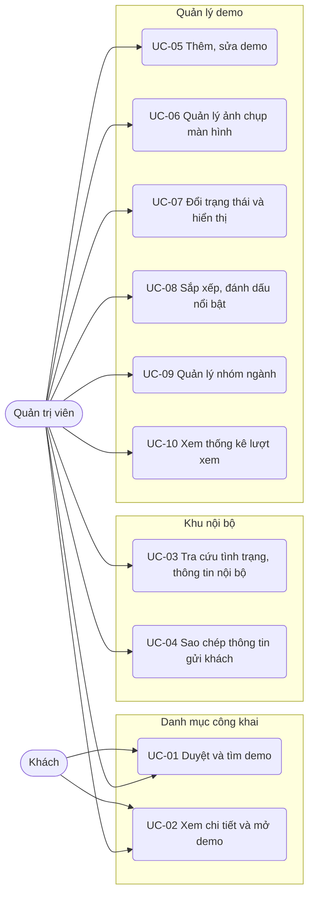

# Đặc tả use case — Danh mục Demo

> Use case phần nền (UC-SYS-01 đến UC-SYS-10): `ZDOCS/03-KIEN-TRUC/USE-CASE-NEN.md`.
> Mã FR, BR, SCR tham chiếu `02-SRS.md`.

---

## 1. Tác nhân

| Tác nhân | Mã vai trò | Use case chính |
| :--- | :--- | :--- |
| Khách | — | UC-01, UC-02 |
| Quản trị viên | `ADMIN` | UC-01 đến UC-10, cộng phần nền (UC-SYS) |

Hệ thống chỉ có hai tác nhân. Quản trị viên là tài khoản `admin` của Mạnh Hùng, vừa cập nhật demo vừa dùng khu nội bộ khi gặp khách.

---

## 2. Sơ đồ use case

---

## 3. Danh sách use case

| Mã | Tên | Tác nhân chính | Module | Ưu tiên | FR |
| :--- | :--- | :--- | :--- | :---: | :--- |
| UC-01 | Duyệt và tìm demo | Khách | Danh mục công khai | P1 | FR-01, FR-02, FR-03, FR-04, FR-05 |
| UC-02 | Xem chi tiết và mở demo | Khách | Danh mục công khai | P1 | FR-06, FR-07, FR-08, FR-09, FR-10, FR-11 |
| UC-03 | Tra cứu tình trạng, thông tin nội bộ | Quản trị viên | Khu nội bộ | P1 | FR-12, FR-13, FR-16 |
| UC-04 | Sao chép thông tin gửi khách | Quản trị viên | Khu nội bộ | P2 | FR-04, FR-14, FR-15 |
| UC-05 | Thêm, sửa demo | Quản trị viên | Quản lý demo | P1 | FR-13, FR-16, FR-17, FR-19, FR-20, FR-24 |
| UC-06 | Quản lý ảnh chụp màn hình | Quản trị viên | Quản lý demo | P1 | FR-18 |
| UC-07 | Đổi trạng thái và hiển thị | Quản trị viên | Quản lý demo | P1 | FR-21, FR-22 |
| UC-08 | Sắp xếp, đánh dấu nổi bật | Quản trị viên | Quản lý demo | P1 | FR-23 |
| UC-09 | Quản lý nhóm ngành | Quản trị viên | Quản lý demo | P2 | FR-25, FR-26 |
| UC-10 | Xem thống kê lượt xem | Quản trị viên | Quản lý demo | P3 | FR-27, FR-28, FR-29 |

---

## 4. Đặc tả chi tiết

### UC-01: Duyệt và tìm demo

| Mục | Nội dung |
| :--- | :--- |
| Tác nhân chính | Khách |
| Mô tả | Xem toàn bộ demo của PUM, lọc theo nhóm ngành, tìm theo từ khóa |
| Ưu tiên | P1 |
| Điều kiện kích hoạt | Khách mở link danh mục do Quản trị viên gửi, hoặc Quản trị viên mở trong buổi gặp |
| Tiền điều kiện | Không cần đăng nhập |
| Hậu điều kiện | Khách thấy danh sách demo phù hợp; không thay đổi dữ liệu |
| Yêu cầu liên quan | FR-01, FR-02, FR-03, FR-04, FR-05, BR-01, BR-03, BR-04, BR-07, BR-13 |
| Màn hình | SCR-01 |

**Luồng chính**

1. Khách mở trang danh mục; hệ thống hiển thị đầu trang (logo, hotline), dòng giới thiệu ngắn, hàng nút nhóm ngành, ô tìm kiếm và lưới thẻ demo theo thứ tự BR-04.
2. Khách bấm một nhóm ngành, vd "F&B"; lưới chỉ còn demo của nhóm đó, nút được tô đậm, đường dẫn đổi thành `/?nganh=fnb`.
3. Khách gõ từ khóa vào ô tìm kiếm; sau khi ngừng gõ 300 ms, hệ thống lọc theo BR-03 trong nhóm đang chọn và hiển thị "Tìm thấy n demo".
4. Khách bấm "Chi tiết" để sang UC-02, hoặc bấm "Xem demo" để mở demo trong tab mới.

**Luồng thay thế**

- 1a. Khách mở đường dẫn có sẵn bộ lọc, vd `/?nganh=fnb&q=pos`: hệ thống áp ngay nhóm ngành và từ khóa.
- 2a. Khách bấm "Tất cả": bỏ lọc nhóm ngành, giữ từ khóa.
- 3a. Từ khóa dưới 2 ký tự: hệ thống không lọc, hiện gợi ý "Nhập ít nhất 2 ký tự".
- 4a. Thẻ "Sắp ra mắt": không có nút "Xem demo"; bấm thẻ thì mở trang chi tiết.
- 4b. Khách bấm hotline ở đầu trang trên điện thoại: máy gọi ngay số hotline của PUM.

**Luồng ngoại lệ**

- E1. Không có demo nào khớp: hệ thống hiển thị "Chưa có demo phù hợp", nút "Xóa bộ lọc" và hotline tư vấn.
- E2. Tham số `nganh` không tồn tại hoặc nhóm không có demo hiển thị: hệ thống bỏ qua tham số, hiển thị "Tất cả" (BR-13).

### UC-02: Xem chi tiết và mở demo

| Mục | Nội dung |
| :--- | :--- |
| Tác nhân chính | Khách |
| Mô tả | Xem ảnh, tính năng, tài khoản của một demo rồi mở demo chạy thật |
| Ưu tiên | P1 |
| Điều kiện kích hoạt | Khách bấm "Chi tiết" ở danh mục hoặc mở link chi tiết được gửi qua Zalo |
| Tiền điều kiện | Demo đang hiển thị (BR-01) |
| Hậu điều kiện | Demo mở trong tab mới; lượt xem, lượt mở demo được ghi (P3) |
| Yêu cầu liên quan | FR-06, FR-07, FR-08, FR-09, FR-10, FR-11, BR-06, BR-07, BR-10, BR-14, BR-16 |
| Màn hình | SCR-02, SCR-03 |

**Luồng chính**

1. Khách mở trang chi tiết; hệ thống hiển thị tên, nhãn nhóm ngành, nhãn trạng thái, mô tả ngắn và ảnh đại diện lớn.
2. Khách bấm một ảnh trong dãy ảnh nhỏ; hệ thống mở hộp xem ảnh phóng to, khách vuốt hoặc bấm phím mũi tên để chuyển ảnh, bấm Esc để đóng.
3. Khách đọc đối tượng khách hàng, vấn đề giải quyết, tính năng nổi bật, thiết bị sử dụng.
4. Khách xem bảng tài khoản demo và hướng dẫn: "Bấm Đăng nhập nhanh trên trang đăng nhập rồi chọn vai trò".
5. Khách bấm "Xem demo"; hệ thống ghi lượt mở demo và mở link demo trong tab mới.

**Luồng thay thế**

- 1a. Khách mở bằng slug cũ: hệ thống chuyển hướng 301 tới slug mới (BR-06).
- 4a. Demo tắt "Cần đăng nhập": thay bảng tài khoản bằng dòng "Không cần đăng nhập".
- 5a. Demo Sắp ra mắt: không có nút "Xem demo"; hiện dòng "Demo đang hoàn thiện, gọi hotline để được giới thiệu trực tiếp".
- 5b. Khách cuộn xuống khu "Demo cùng ngành", chọn một demo khác; quay lại bước 1.

**Luồng ngoại lệ**

- E1. Slug không tồn tại hoặc demo không hiển thị, khách chưa đăng nhập: hệ thống hiển thị trang "Không tìm thấy demo" có nút về danh mục.
- E2. Demo chưa có ảnh chụp: hệ thống dùng ảnh mặc định theo màu nhóm ngành kèm tên demo (BR-07).

### UC-03: Tra cứu tình trạng, thông tin nội bộ

| Mục | Nội dung |
| :--- | :--- |
| Tác nhân chính | Quản trị viên |
| Mô tả | Xem demo nào chạy được, đọc mật khẩu, ghi chú, kịch bản trước buổi gặp khách |
| Ưu tiên | P1 |
| Điều kiện kích hoạt | Quản trị viên chuẩn bị gặp khách hoặc khách hỏi về một ngành cụ thể |
| Tiền điều kiện | Đã đăng nhập `admin`; có quyền `demos.view` và `demos.view-internal` |
| Hậu điều kiện | Không thay đổi dữ liệu |
| Yêu cầu liên quan | FR-12, FR-13, FR-16, BR-10 |
| Màn hình | SCR-05, SCR-02 |

**Luồng chính**

1. Quản trị viên đăng nhập; hệ thống mở trang Quản lý demo, đầu trang có thẻ tổng hợp: tổng số demo, số Hoàn thiện, Demo được, Đang làm, Mới tạo, số đang hiển thị, số nổi bật trên 6.
2. Quản trị viên lọc nhóm ngành của khách sắp gặp, vd "F&B"; bảng hiển thị các demo của nhóm kèm trạng thái, hiển thị, người phụ trách.
3. Quản trị viên bấm tên một demo; hệ thống mở trang chi tiết kèm khung "Thông tin nội bộ": trạng thái phát triển, người phụ trách, mật khẩu demo, link Swagger, repo, ghi chú nội bộ, kịch bản tóm tắt, câu hỏi khách hay hỏi.
4. Quản trị viên bấm biểu tượng sao chép cạnh mật khẩu hoặc mở kịch bản để ôn trước buổi gặp.

**Luồng thay thế**

- 1a. Quản trị viên đang đăng nhập mở thẳng trang danh mục công khai: trang chi tiết vẫn có khung "Thông tin nội bộ".
- 3a. Demo chưa công khai: trang chi tiết mở ở chế độ xem trước, có dải nhãn vàng "Xem trước, khách không thấy trang này".

**Luồng ngoại lệ**

- E1. Người xem không có quyền `demos.view-internal` (khách chưa đăng nhập, hoặc tài khoản thuộc vai trò khác nếu sau này có): không có khung nội bộ; mở demo chưa công khai thì hiện "Không tìm thấy demo"; API không trả mật khẩu, ghi chú (BR-10).
- E2. Tài khoản không có quyền `demos.update` (chỉ xảy ra nếu sau này cấp thêm vai trò khác): nút "Thêm demo", "Sửa" không hiển thị.

### UC-04: Sao chép thông tin gửi khách

| Mục | Nội dung |
| :--- | :--- |
| Tác nhân chính | Quản trị viên |
| Mô tả | Chép sẵn link, tài khoản, hướng dẫn đăng nhập để dán vào Zalo gửi khách |
| Ưu tiên | P2 |
| Yêu cầu liên quan | FR-04, FR-14, FR-15, BR-17 |
| Màn hình | SCR-02, SCR-04, SCR-01 |

**Luồng chính**

1. Trên trang chi tiết, Quản trị viên bấm "Sao chép gửi khách".
2. Hệ thống mở hộp xem trước nội dung theo mẫu BR-17; ô "Kèm mật khẩu" mặc định để trống.
3. Quản trị viên bấm "Sao chép"; hệ thống chép vào bộ nhớ tạm và báo "Đã sao chép".
4. Quản trị viên dán vào Zalo gửi khách.
5. Muốn gửi cả nhóm demo, Quản trị viên lọc ngành ở trang danh mục rồi bấm "Sao chép link"; hệ thống chép đường dẫn có tham số lọc.

### UC-05: Thêm, sửa demo

| Mục | Nội dung |
| :--- | :--- |
| Tác nhân chính | Quản trị viên |
| Mô tả | Khai báo demo mới hoặc cập nhật thông tin, tài khoản demo, ghi chú nội bộ; xóa demo nhập sai |
| Ưu tiên | P1 |
| Điều kiện kích hoạt | Kho có dự án demo mới, hoặc demo đổi tính năng, link, tài khoản |
| Tiền điều kiện | Có quyền `demos.create` hoặc `demos.update`; xóa cần `demos.delete` |
| Hậu điều kiện | Demo được lưu; demo đang hiển thị cập nhật trên danh mục trong 60 giây (NFR-05) |
| Yêu cầu liên quan | FR-13, FR-16, FR-17, FR-19, FR-20, FR-24, BR-02, BR-05, BR-06, BR-08, BR-09, BR-12, BR-16 |
| Màn hình | SCR-05, SCR-06 |

**Luồng chính (thêm demo)**

1. Quản trị viên mở Quản lý demo, bấm "Thêm demo".
2. Hệ thống mở trang thêm mới với số thứ tự gợi ý bằng số lớn nhất cộng 1, trạng thái Mới tạo, Hiển thị tắt.
3. Ở tab Thông tin, Quản trị viên nhập mã dự án và tên; hệ thống tự sinh slug (BR-05) và thư mục (BR-09).
4. Quản trị viên chọn nhóm ngành, nhập ý tưởng gốc, đối tượng khách hàng, vấn đề giải quyết, loại sản phẩm, thiết bị, mô tả ngắn, mô tả chi tiết, tính năng nổi bật (tối đa 6, cần ít nhất 3 để hiển thị), từ khóa, link demo, link Swagger, repo, người phụ trách.
5. Ở tab Tài khoản demo, Quản trị viên bật "Cần đăng nhập", thêm từng tài khoản (tên đăng nhập, tên vai trò, dùng để xem gì) và nhập mật khẩu demo.
6. Ở tab Nội bộ, Quản trị viên nhập ghi chú nội bộ, kịch bản tóm tắt, câu hỏi khách hay hỏi kèm câu trả lời gợi ý.
7. Quản trị viên bấm "Lưu"; hệ thống kiểm tra BR-05, BR-08, BR-09, BR-16, lưu demo và quay về danh sách.

**Luồng thay thế**

- 1a. Sửa demo: chọn demo trong bảng, sửa các tab, bấm "Lưu".
- 3a. Đổi slug của demo đã từng công khai: hệ thống cảnh báo "Link cũ sẽ tự chuyển sang link mới" và lưu slug cũ (BR-06).
- 7a. Bấm "Xem trước": hệ thống mở trang chi tiết ở chế độ xem trước trong tab mới.
- 7b. Quản trị viên bấm "Xóa" trên demo chưa từng công khai, xác nhận; hệ thống xóa demo (BR-12).

**Luồng ngoại lệ**

- E1. Mã dự án, số thứ tự hoặc slug trùng: báo lỗi tại ô tương ứng, không lưu.
- E2. Mô tả ngắn ngoài 50–160 ký tự hoặc nhiều hơn 6 tính năng nổi bật: báo lỗi tại ô, không lưu (BR-08).
- E3. Link demo, link Swagger, repo không bắt đầu bằng `http://` hoặc `https://`: báo lỗi tại ô.
- E4. Sửa demo đang hiển thị làm mất điều kiện BR-02 (vd xóa bớt còn 2 tính năng, xóa hết tài khoản demo): hệ thống không lưu, báo "Demo đang hiển thị, cần tắt hiển thị trước".
- E5. Xóa demo đã từng công khai: nút "Xóa" bị vô hiệu, chú thích "Demo đã từng công khai, chỉ tắt hiển thị được".

### UC-06: Quản lý ảnh chụp màn hình

| Mục | Nội dung |
| :--- | :--- |
| Tác nhân chính | Quản trị viên |
| Mô tả | Tải lên, sắp xếp, xóa ảnh chụp và chọn ảnh đại diện của demo |
| Ưu tiên | P1 |
| Điều kiện kích hoạt | Demo vừa chạy được hoặc đổi giao diện |
| Tiền điều kiện | Có quyền `demos.update` |
| Hậu điều kiện | Thư viện ảnh và ảnh đại diện trên danh mục cập nhật |
| Yêu cầu liên quan | FR-18, BR-02, BR-07 |
| Màn hình | SCR-06 |

**Luồng chính**

1. Quản trị viên mở demo, chọn tab Ảnh chụp; hệ thống hiển thị ảnh hiện có theo thứ tự, ảnh đại diện có nhãn "Đại diện".
2. Quản trị viên kéo thả hoặc chọn ảnh từ máy; hệ thống kiểm tra BR-07 và hiển thị tiến độ tải từng ảnh.
3. Quản trị viên nhập chú thích cho từng ảnh, vd "Màn bán hàng trên tablet".
4. Quản trị viên kéo thả để đổi thứ tự, bấm "Đặt làm ảnh đại diện" cho một ảnh.
5. Quản trị viên bấm "Lưu"; hệ thống lưu thứ tự, chú thích, ảnh đại diện.

**Luồng thay thế**

- 2a. Demo chưa có ảnh đại diện: ảnh đầu tiên tự làm ảnh đại diện.
- 4a. Xóa ảnh: bấm biểu tượng xóa, xác nhận; nếu xóa ảnh đại diện thì ảnh kế tiếp thành ảnh đại diện.

**Luồng ngoại lệ**

- E1. Ảnh sai định dạng, quá 2 MB hoặc rộng dưới 1280 px: báo lỗi riêng từng ảnh, các ảnh hợp lệ vẫn được tải.
- E2. Vượt 8 ảnh: báo "Mỗi demo tối đa 8 ảnh", chỉ nhận đủ số ảnh còn lại theo thứ tự đã chọn.
- E3. Xóa ảnh cuối cùng của demo đang công khai: hệ thống từ chối vì vi phạm BR-02.

### UC-07: Đổi trạng thái và hiển thị

| Mục | Nội dung |
| :--- | :--- |
| Tác nhân chính | Quản trị viên |
| Mô tả | Cập nhật mức hoàn thiện của demo, quyết định demo nào khách thấy |
| Ưu tiên | P1 |
| Điều kiện kích hoạt | Demo vừa chạy được, hoặc demo gặp lỗi cần ẩn |
| Tiền điều kiện | Có quyền `demos.publish` |
| Hậu điều kiện | Trạng thái mới được lưu kèm lịch sử; danh mục cập nhật theo BR-01, BR-04 |
| Yêu cầu liên quan | FR-21, FR-22, BR-01, BR-02, BR-04, BR-11 |
| Màn hình | SCR-05, SCR-06 |

**Luồng chính (công khai demo vừa chạy được)**

1. Quản trị viên mở Quản lý demo, chọn một demo đang ở trạng thái Đang làm.
2. Quản trị viên bấm "Đổi trạng thái", chọn "Demo được".
3. Hệ thống kiểm tra: tiến bậc không cần lý do; demo đang hiển thị thì kiểm tra thêm BR-02.
4. Hệ thống lưu trạng thái, ghi lịch sử (trạng thái cũ, mới, người đổi, thời điểm).
5. Quản trị viên bật công tắc "Hiển thị"; hệ thống kiểm tra BR-02, đủ điều kiện thì demo xuất hiện trên danh mục với nút "Xem demo" và ghi ngày công khai đầu tiên nếu là lần đầu.

**Luồng thay thế**

- 2a. Lùi bậc, vd Hoàn thiện → Demo được khi BE đang lỗi: bắt buộc nhập lý do 10–500 ký tự (BR-11).
- 2b. Lùi về Đang làm khi demo đang công khai: hệ thống bỏ nổi bật, thẻ trên danh mục chuyển "Sắp ra mắt".
- 2c. Lùi về Mới tạo: hệ thống tự tắt Hiển thị, bỏ nổi bật và thông báo cho Quản trị viên.
- 5a. Demo Đang làm bật Hiển thị: demo xuất hiện dạng "Sắp ra mắt", không có nút "Xem demo".
- 5b. Tắt Hiển thị: demo biến mất khỏi danh mục; khách mở link chi tiết thấy "Không tìm thấy demo".

**Luồng ngoại lệ**

- E1. Thiếu điều kiện BR-02: hệ thống liệt kê từng mục thiếu, vd "Cần ít nhất 1 ảnh chụp màn hình", không đổi trạng thái hoặc không bật Hiển thị.
- E2. Bật Hiển thị cho demo Mới tạo: công tắc bị vô hiệu, chú thích "Chuyển sang Đang làm trở lên trước".
- E3. Lùi bậc mà chưa nhập lý do hoặc lý do dưới 10 ký tự: nút "Lưu" bị vô hiệu.

### UC-08: Sắp xếp, đánh dấu nổi bật

| Mục | Nội dung |
| :--- | :--- |
| Tác nhân chính | Quản trị viên |
| Mô tả | Chọn demo đưa lên đầu danh mục và sắp thứ tự hiển thị |
| Ưu tiên | P1 |
| Điều kiện kích hoạt | Có demo mới cần đẩy, hoặc chuẩn bị đợt chào hàng cho một ngành |
| Tiền điều kiện | Có quyền `demos.publish` |
| Hậu điều kiện | Danh mục hiển thị theo thứ tự mới (BR-04) |
| Yêu cầu liên quan | FR-23, BR-04, BR-18 |
| Màn hình | SCR-05 |

**Luồng chính**

1. Quản trị viên mở Quản lý demo, bấm "Sắp xếp"; bảng hiển thị theo thứ tự hiện tại, mỗi dòng có tay nắm kéo và ngôi sao nổi bật.
2. Quản trị viên kéo một demo tới vị trí mới; hệ thống đánh lại thứ tự 10, 20, 30… (BR-18).
3. Quản trị viên bấm ngôi sao để đánh dấu nổi bật; bộ đếm "Nổi bật 5/6" cập nhật.
4. Quản trị viên bấm "Lưu thứ tự"; danh mục hiển thị theo thứ tự mới.

**Luồng thay thế**

- 3a. Bỏ nổi bật: bấm lại ngôi sao đang sáng; bộ đếm giảm 1.

**Luồng ngoại lệ**

- E1. Đánh dấu nổi bật khi đã đủ 6: hệ thống báo "Tối đa 6 demo nổi bật, hãy bỏ bớt một demo".
- E2. Đánh dấu nổi bật demo Sắp ra mắt hoặc chưa hiển thị: ngôi sao bị vô hiệu, chú thích "Chỉ demo đang công khai mới được nổi bật".
- E3. Đang lọc hoặc tìm kiếm: nút "Sắp xếp" bị vô hiệu, chú thích "Bỏ lọc để sắp xếp toàn bộ danh sách".

### UC-09: Quản lý nhóm ngành

| Mục | Nội dung |
| :--- | :--- |
| Tác nhân chính | Quản trị viên |
| Mô tả | Thêm, sửa, sắp xếp, xóa nhóm ngành dùng để lọc demo |
| Ưu tiên | P2 |
| Yêu cầu liên quan | FR-25, FR-26, BR-13 |
| Màn hình | SCR-07 |

**Luồng chính**

1. Quản trị viên mở Nhóm ngành; hệ thống hiển thị 11 nhóm kèm biểu tượng, màu nhãn, số demo.
2. Quản trị viên bấm "Thêm" hoặc chọn một nhóm để sửa tên, slug, biểu tượng, màu nhãn, mô tả.
3. Quản trị viên kéo thả để đổi thứ tự; hàng nút nhóm ngành trên danh mục đi theo thứ tự này.
4. Quản trị viên bấm "Lưu"; với nhóm không còn demo, Quản trị viên bấm "Xóa" và xác nhận.
