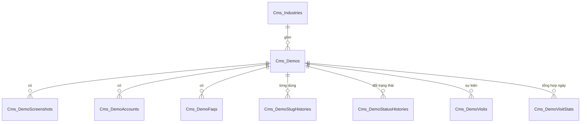

# Thiết kế CSDL — Danh mục Demo

> Database: `WebDemo_WebDanhMucDemo`.
> Quy ước chung và nhóm bảng nền `System_*` (tài khoản, vai trò, quyền, cài đặt, nhật ký): xem `ZDOCS/03-KIEN-TRUC/THIET-KE-CSDL-NEN.md`.
> File này chỉ mô tả **bảng nghiệp vụ riêng của dự án**. Area: `Cms`.

---

## 1. Sơ đồ

---

## 2. Danh sách bảng

| Bảng | Mô tả | Dữ liệu mẫu |
| :--- | :--- | :---: |
| `Cms_Industries` | Nhóm ngành | 11 |
| `Cms_Demos` | Demo | 18 |
| `Cms_DemoScreenshots` | Ảnh chụp màn hình | 54 |
| `Cms_DemoAccounts` | Tài khoản demo | 59 |
| `Cms_DemoFaqs` | Câu hỏi khách hay hỏi (nội bộ) | 26 |
| `Cms_DemoSlugHistories` | Slug cũ để chuyển hướng 301 | 0 |
| `Cms_DemoStatusHistories` | Lịch sử đổi trạng thái phát triển | 50 |
| `Cms_DemoVisits` | Sự kiện xem, mở demo (thô, dùng chống tính trùng) | 0 |
| `Cms_DemoVisitStats` | Lượt xem, lượt mở tổng hợp theo ngày | 585 (13 demo hiển thị, 15–75 ngày gần nhất) |

Dữ liệu mẫu nằm ở `FE/src/mock/seed/demo-data.json` (nguồn duy nhất, BE nhúng file này khi seed). `DemoDataSeeder` suy ra trường file seed chưa ghi giống FE mock: thứ tự = số thứ tự × 10; link demo `http://localhost:31NN`, Swagger `https://localhost:71NN/swagger`, repo `https://github.com/HungNDM-Web-Demo/{thư mục}`; mật khẩu demo = `DEMO_PASSWORD` khi cần đăng nhập; ảnh `/seed/demos/{slug}/{file}`, thiếu kích thước thì 1600×1000, dung lượng 0. Đặt lại dữ liệu xóa toàn bộ bảng `Cms_*` (bảng con trước) và thư mục `wwwroot/uploads/demos`.

---

## 3. Mô tả bảng

Mọi bảng có cột chung `Id`, `CreatedAt`, `CreatedBy`, `UpdatedAt`, `UpdatedBy` theo `THIET-KE-CSDL-NEN.md` §1. Bảng `Cms_*` xóa cứng (không có `IsDeleted`): chỉ demo chưa từng công khai và nhóm ngành không còn demo mới xóa được. `Id` sinh ở code, kể cả bảng con thêm qua demo. Migration: gộp trong `Initial_System` (Postgres); SQLite và SQL Server tạo bảng bằng EnsureCreated.

### `Cms_Industries`: nhóm ngành

| Cột | Kiểu | Ràng buộc | Ghi chú |
| :--- | :--- | :--- | :--- |
| `Code` | `smallint` | unique, 1–99 | Mã nhóm theo `DANH-SACH-Y-TUONG.md` (1 F&B … 11 Ngành khác) |
| `Name` | `varchar(60)` | bắt buộc | Tên trên nút lọc |
| `Slug` | `varchar(40)` | unique | `fnb`, `ban-le`… dùng trong `?nganh=` |
| `Icon` | `varchar(40)` | | Tên icon lucide, vd `UtensilsCrossed` |
| `Color` | `varchar(20)` | bắt buộc | Mã màu nhãn và ảnh mặc định, vd `#EA580C` |
| `Description` | `varchar(300)` | | |
| `SortOrder` | `integer` | | Thứ tự nút trên danh mục |

### `Cms_Demos`: demo

| Cột | Kiểu | Ràng buộc | Ghi chú |
| :--- | :--- | :--- | :--- |
| `Number` | `smallint` | unique, 1–99 | Số thứ tự 2 chữ số (BR-09) |
| `ProjectCode` | `varchar(40)` | unique | Không đổi sau khi tạo (BR-09). Thư mục = `{Number:00}-{ProjectCode}`, không lưu |
| `Name` | `varchar(60)` | bắt buộc | |
| `Slug` | `varchar(60)` | unique | BR-05; không trùng cả slug cũ (BR-06) |
| `IndustryId` | `uuid` | FK `Cms_Industries` | |
| `IdeaCode` | `varchar(10)` | | Mã ý tưởng gốc, vd `1.1` |
| `TargetCustomers` | `varchar(300)` | | Đối tượng khách hàng |
| `ProblemSolved` | `varchar(1000)` | | Vấn đề giải quyết |
| `ProductType` | `varchar(150)` | | Loại sản phẩm |
| `Devices` | `varchar(150)` | | Thiết bị sử dụng |
| `ShortDescription` | `varchar(160)` | | 50–160 ký tự khi nhập (BR-08) |
| `Description` | `text` | | Mô tả chi tiết, đoạn văn thuần |
| `FeaturesJson` | `text` | | Mảng JSON chuỗi, tối đa 6 × 80 ký tự |
| `KeywordsJson` | `text` | | Mảng JSON chuỗi, tối đa 10 |
| `DemoUrl` | `varchar(300)` | | Link Xem demo. Seed ghi link thật khi demo đã đưa lên mạng, không ghi thì suy ra `http://localhost:31NN` |
| `SwaggerUrl` | `varchar(300)` | | Nội bộ |
| `RepoUrl` | `varchar(300)` | | Nội bộ |
| `OwnerName` | `varchar(100)` | | Người phụ trách, nội bộ |
| `RequiresLogin` | `boolean` | mặc định 1 | BR-16 |
| `DemoPassword` | `varchar(100)` | | Nội bộ |
| `InternalNotes` | `varchar(2000)` | | Nội bộ |
| `DemoScript` | `text` | | Kịch bản tóm tắt, nội bộ |
| `DevStatus` | `integer` | | Enum `DemoDevStatus` |
| `IsVisible` | `boolean` | mặc định 0 | |
| `IsFeatured` | `boolean` | mặc định 0 | |
| `SortOrder` | `integer` | 1–999 | BR-18 |
| `FirstPublishedAt` | `timestamptz` | null | Lần đầu vừa hiển thị vừa ở Demo được/Hoàn thiện |

Index: `IX_Cms_Demos_Visible_Sort (IsVisible, SortOrder)`; unique `Number`, `ProjectCode`, `Slug`. FK `IndustryId` chặn xóa (BR-13); bảng con của demo xóa theo demo.

Enum `DemoDevStatus`:

| Giá trị | Tên | Hiển thị |
| :---: | :--- | :--- |
| 0 | `MoiTao` | Mới tạo |
| 1 | `DangLam` | Đang làm |
| 2 | `DemoDuoc` | Demo được |
| 3 | `HoanThien` | Hoàn thiện |

### `Cms_DemoScreenshots`: ảnh chụp

| Cột | Kiểu | Ràng buộc | Ghi chú |
| :--- | :--- | :--- | :--- |
| `DemoId` | `uuid` | FK, xóa theo demo | |
| `Url` | `varchar(500)` | bắt buộc | `/seed/demos/{slug}/{file}` (ảnh mẫu, FE phục vụ) hoặc `/uploads/demos/{yyyy}/{MM}/{guid}.{ext}` (ảnh tải lên, theo cách lưu của `IFileStorage` nền) |
| `Caption` | `varchar(125)` | | |
| `Width`, `Height` | `integer` | | Rộng tối thiểu 1280 (BR-07) |
| `SizeBytes` | `integer` | | Tối đa 2 MB |
| `SortOrder` | `integer` | | |
| `IsCover` | `boolean` | | Đúng 1 ảnh là đại diện khi demo có ảnh |

### `Cms_DemoAccounts`: tài khoản demo

| Cột | Kiểu | Ràng buộc | Ghi chú |
| :--- | :--- | :--- | :--- |
| `DemoId` | `uuid` | FK | |
| `Username` | `varchar(50)` | không trùng trong demo | BR-SYS-01. Kiểm tra khi lưu; index `(DemoId, Username)` không unique để đổi chỗ hai tài khoản trong một lần lưu không vướng ràng buộc tạm thời |
| `RoleName` | `varchar(60)` | bắt buộc | vd "Thu ngân" |
| `Purpose` | `varchar(200)` | | Dùng để xem gì |
| `SortOrder` | `integer` | | |

### `Cms_DemoFaqs`: câu hỏi khách hay hỏi

| Cột | Kiểu | Ghi chú |
| :--- | :--- | :--- |
| `DemoId` | `uuid` | FK |
| `Question` | `varchar(300)` | |
| `Answer` | `varchar(1000)` | Câu trả lời gợi ý |
| `SortOrder` | `integer` | |

### `Cms_DemoSlugHistories`: slug cũ

| Cột | Kiểu | Ràng buộc | Ghi chú |
| :--- | :--- | :--- | :--- |
| `DemoId` | `uuid` | FK | |
| `Slug` | `varchar(60)` | unique | Không dùng lại cho demo khác (BR-06) |
| `ChangedAt` | `timestamptz` | | |

### `Cms_DemoStatusHistories`: lịch sử trạng thái

| Cột | Kiểu | Ghi chú |
| :--- | :--- | :--- |
| `DemoId` | `uuid` | FK |
| `FromStatus` | `integer` null | null khi tạo mới |
| `ToStatus` | `integer` | |
| `Reason` | `varchar(500)` | Bắt buộc 10–500 ký tự khi lùi bậc (BR-11) |
| `ChangedByName` | `varchar(150)` | Tên đăng nhập người đổi |
| `ChangedAt` | `timestamptz` | |

### `Cms_DemoVisits`: sự kiện truy cập (thô)

| Cột | Kiểu | Ghi chú |
| :--- | :--- | :--- |
| `DemoId` | `uuid` | FK |
| `Type` | `integer` | `0 View`, `1 Open` |
| `VisitorId` | `varchar(64)` | Mã ngẫu nhiên lưu trên trình duyệt (BR-14) |
| `Device` | `integer` | `0 Mobile`, `1 Desktop` |
| `Referrer` | `varchar(300)` | |
| `OccurredAt` | `timestamptz` | |

Index `(DemoId, VisitorId, Type, OccurredAt)` và `OccurredAt`. Chỉ dùng để chống tính trùng trong 30 phút; job `DemoVisitCleanupJob` dọn bản ghi cũ hơn 2 ngày (lúc khởi động rồi mỗi 6 giờ). Không ghi nhật ký thao tác (`IAuditLogExempt`).

### `Cms_DemoVisitStats`: tổng hợp theo ngày

| Cột | Kiểu | Ràng buộc | Ghi chú |
| :--- | :--- | :--- | :--- |
| `DemoId` | `uuid` | FK | |
| `Date` | `date` | unique cùng `DemoId` | Ngày theo giờ Việt Nam |
| `Views` | `integer` | | |
| `Opens` | `integer` | | |
| `MobileViews` | `integer` | | |
| `DesktopViews` | `integer` | | |

Mỗi sự kiện được tính (không trùng) cộng thẳng vào dòng của ngày đó. Báo cáo chỉ đọc bảng này. Không ghi nhật ký thao tác (`IAuditLogExempt`).
